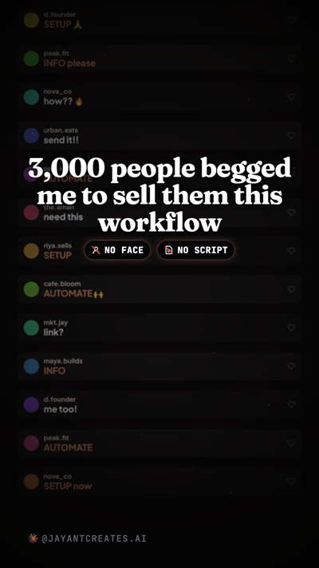
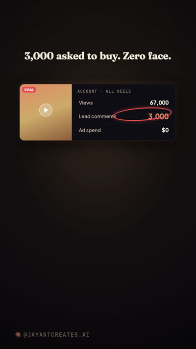
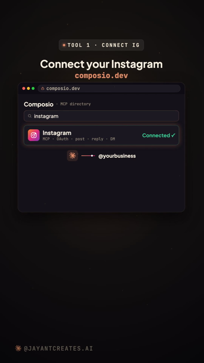
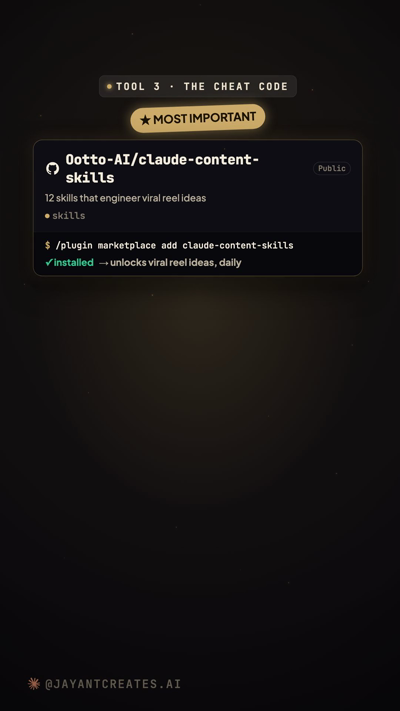
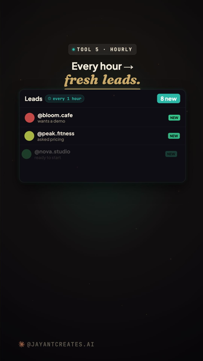
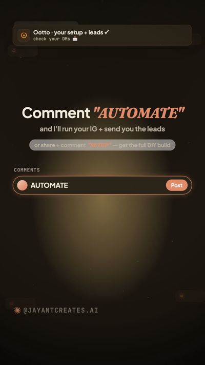

<p align="center">
  
</p>

<h1 align="center">Claude Instagram Autopilot</h1>

<p align="center"><strong>A faceless Instagram lead machine, run by Claude.</strong><br>
Find what's trending → write the reel in your voice → render it → post it → DM every commenter their lead magnet — on a schedule, while you sleep.</p>

<p align="center">
  <a href="#the-5-tool-setup">The 5 tools</a> ·
  <a href="#auto-generate-the-github-action">Auto-generate</a> ·
  <a href="#create-reels-with-remotion">Remotion (create reels)</a> ·
  <a href="#the-lead-loop">Lead loop</a>
</p>

---

> **Proof it works** — a faceless page an AI runs: **67,000 views · 3,000+ lead comments across all reels · $0 in ads.**
> Tool **3** is the cheat code.

<p align="center">
  
</p>

---

## The 5-tool setup

Everything here is **free**. Do them in order.

### 1 · Connect your Instagram → Composio
Give Claude the ability to post + reply on your account.
- Go to **[composio.dev](https://composio.dev)** → search **Instagram** in the MCP directory → **Connect** (OAuth, Business/Creator account).
- Add the MCP to Claude. Now Claude can post reels, reply to comments, and send DMs.

<p align="center"></p>

### 2 · Give Claude eyes on Reddit + X → agent-reach
So Claude knows what your niche is actually begging for.
- Repo: **[github.com/Panniantong/Agent-Reach](https://github.com/Panniantong/Agent-Reach)** ⭐ 48k+
- Ask Claude: *"install the agent-reach skill."* Now it can read trending Reddit threads + X posts.

### 3 · 🔑 The cheat code → claude-content-skills
This is the one nobody talks about. It turns "what's trending" into a **proven viral reel idea** every day.
- Repo: **[github.com/Ootto-AI/claude-content-skills](https://github.com/Ootto-AI/claude-content-skills)**
- Install: `/plugin marketplace add Ootto-AI/claude-content-skills`
- 12 skills: find viral reels → tear them down → write the hook + script → build the reel → caption → comment→DM lead loop.

<p align="center"></p>

### 4 · Give Claude your tone → it writes the reel
- Feed Claude 5–10 of your best posts and say *"learn my tone."*
- Then: *"make today's reel."* It writes + builds the whole thing — in your voice, not a robot's.

### 5 · Put it on autopilot → a scheduled task
- One task, runs **every hour**: check comments + DMs → message you the new leads → update your dashboard.
- Use **Claude Cowork / a scheduled task**, or the **[auto-generate GitHub Action](#auto-generate-the-github-action)** below.

<p align="center"></p>

---

## Auto-generate (the GitHub Action)

`.github/workflows/autopilot.yml` runs on a schedule (default: daily). Each run asks Claude to:
1. pull what's trending in your niche (agent-reach),
2. write + build the next reel (content-skills),
3. drop a ready-to-review `carousel.json` + rendered `reel.mp4` into the repo (or your storage).

**Setup:** add your `ANTHROPIC_API_KEY` (and IG/Composio keys) as repo **Secrets**, set your niche in `auto-generate/config.yml`, enable Actions. It's a **review-gate** by default — nothing auto-posts until you approve (flip `AUTO_POST=true` once you trust it).

---

## Create reels with Remotion

The reels are composed in **[Remotion](https://remotion.dev)** (React → MP4). A starter project lives in **[`remotion/`](remotion/)** — it renders a `carousel.json` into a vertical 9:16 reel (kinetic hook → tool/list beats → CTA), brand-themeable.

```bash
cd remotion
npm install
npx remotion render src/index.tsx Reel out/reel.mp4 --props=./sample-carousel.json
```

Claude writes the `carousel.json`; Remotion renders the video. See [`remotion/README.md`](remotion/README.md).

> The full production scene library (dozens of animated scenes) powers the hosted **[Ootto](https://www.ootto.ai)** product; this starter is the open template to build your own.

---

## The lead loop

The reel's CTA is *"comment a keyword → I'll DM you the thing."* A cloud monitor watches comments and auto-replies + DMs the resource 24/7 (public reply is link-free; the link goes in the DM). Template: **[github.com/Ootto-AI/claude-figma-stack](https://github.com/Ootto-AI/claude-figma-stack)**.

<p align="center"></p>

---

## Guardrails
- **Human-approval first.** Nothing auto-posts until you flip it on.
- **Be honest.** Any number you put on screen must be real/defensible. Instagram posts can't be deleted via API.
- **Original only.** Model the *format* of what's working; write your own words + visuals.

---

Built by **[Ootto](https://www.ootto.ai)** — the AI autopilot that runs your content + leads. This repo is the do-it-yourself version.
